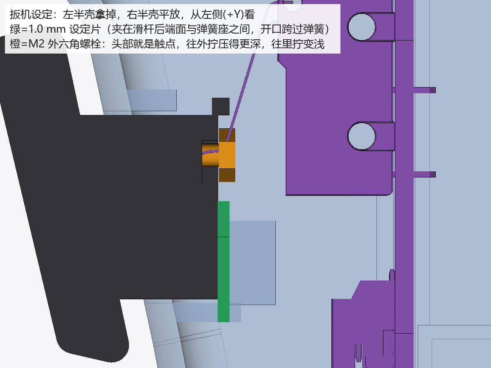

# 枪型飞鼠工程样 EVT-A：下单与组装说明

日期：2026-10-06。分支 `claude/evt-a`，从 `codex/pcb-shell-finish`（`2afed8f`）分出；正式基线 `deliverables/pcb-shell-v1/` 和原 AI 工作区都没有改动。

这一版是**工程样**：电路板布局不变，只改两颗电阻的阻值；按钮公差问题由打印件解决。目的是拿到实测数据（充电温度、拔插 USB、底口下载、蓝牙信号、扳机与右键手感），再一次性改板。改动理由见 `docs/工程样A阶段-复审结论与改动.md`。

## 一、下单（嘉立创常规贴片加插件即可，不需要提任何特殊要求）

上传 `制板文件/` 里的三个文件：

| 文件 | 和正式版的区别 |
| --- | --- |
| `gun-mouse-v1-Gerber.zip` | 完全相同（逐字节一致） |
| `gun-mouse-v1-BOM.csv` | R3 由 3.3kΩ 改为 6.8kΩ（立创 C25917），R5 由 100kΩ 改为 10kΩ（C25744，板上已有此料） |
| `gun-mouse-v1-坐标文件.csv` | 只改 R3、R5 两行的型号与阻值，坐标不变 |

- R3 把充电电流从约 360 mA 降到约 176 mA，芯片发热约减半，充满约 4.5 小时。R5 加快拔 USB 时的电源切换。
- 扳机小板请多贴 1–2 块作备用：它通过插头连接，开关万一有问题，换一块就行，不用焊。
- 不要勾选“清洗”增值服务（嘉立创默认不清洗；两个微动开关不能清洗）。
- 6.8kΩ 料号是否属于基础库，以下单时的匹配结果为准。

## 二、打印（`打印文件/`，STL 已摆好打印姿态，STEP 为整机坐标）

| 零件 | 状态 | 说明 |
| --- | --- | --- |
| `左半壳-EVT-A` | 改 | 扳机硬限位处让开 0.3 mm（硬限位改由右半壳承担） |
| `右半壳-EVT-A` | 改 | 硬限位块整块归右半壳；新增右键背后 3 根支撑柱；含预审的摇杆背部支撑柱 |
| `扳机-EVT-A` | 改 | 原固定触点改为 M2 螺栓头；尾部有螺栓头槽，+Y 侧开口；触摸线槽尾段移到 +Y 侧；含预审的端接避让腔 |
| `右键帽-EVT-A` | 改 | 帽沿落壳是独立限位：帽杆静止端面距板 7.30 mm，帽沿行程 0.80 mm，到底停在距板 6.50 mm，不压到开关外壳 |
| `扳机设定片-0.8mm / 1.0mm / 1.2mm` | 新 | 平放打印，层高 0.2（正好 4/5/6 层）；手柄末端缺口数 1/2/3 对应 0.8/1.0/1.2 |
| `扳机触摸面盖`、`摇杆帽` | 未改 | 原件复制 |

打印参数沿用正式版建议：PLA 或 PETG、0.4 喷嘴、层高 0.2、3 圈壁、填充 20%。右半壳因硬限位块跨过分壳面，打印高度从约 18.4 mm 变为约 25.5 mm。设定片打完用卡尺量一下厚度，偏差在 ±0.05 mm 内即可用。

## 三、另外要买的

在正式版购物清单（`deliverables/pcb-shell-v1/README.md` 第二节）基础上，增加：

- M2×10 外六角螺栓（GB/T 5783 或 DIN 933，不锈钢）2 颗，1 颗备用。
- 万用表（有蜂鸣档；最好带温度探头，用来测充电温度）。

## 四、组装时你要做的几件事

1. **掰下扳机小板**：卡槽已给邮票孔毛刺留了 0.9 mm 余量，一般不用打磨。
2. **插电池前量极性**：主板 J3 的 1 脚（丝印 BAT+）是正极。淘宝 PH2.0 电池正负接法不统一，接反会烧板。
3. **首次烧录**：开发板先用它自己的 USB 口烧好 `固件/` 里的程序（见第七节），再插到主板上。不要在开发板插在主板上时用它自己的 USB 口。
4. **扳机触点设定（只做一次，约 2 分钟）**，见下节。

按正式版第四节的顺序装右半壳：电池、扳机小板、弹簧和扳机、主板。然后**先做扳机设定，再合左半壳**。

## 五、扳机触点设定



1. 把 M2 螺栓拧进扳机尾部的孔，露出约 2 mm 螺纹（大致是原设计位置）。
2. 右半壳平放，左半壳先不装。扳机小板到主板的那根线从主板 J4 拔下，万用表蜂鸣档接在线的这一头。
3. 把 **1.0 mm 设定片**插进滑杆后端面与弹簧座之间，开口跨过弹簧，然后把扳机压住不放。
4. 转螺栓头（手指或镊子，从 +Y 侧够得到）：
   - 往外拧，触点更压向开关；往里拧，变浅。每圈 0.4 mm。
   - 如果一压就响：先往里拧到不响，再慢慢往外拧，**刚响就停**。
   - 如果不响：慢慢往外拧，**刚响就停**。
   - 最后一步总是往外拧到刚响，因为开关的通断点有回差。
5. 松开扳机，抽出设定片，复查：
   - 换 **0.8 mm** 片压到底：**必须响**。
   - 换 **1.2 mm** 片，从松开状态压到底：**必须不响**。
   - 都满足，说明扳机按到底时开关越过动作点约 0.8–1.2 mm，基本在欧姆龙建议的额定余行程 70%–100%（0.84–1.2 mm）内。
6. 拔掉万用表，把线插回 J4，装右键帽，合左半壳拧螺丝。螺纹靠摩擦自锁，不要加螺纹胶或瞬干胶（胶的挥发物会损坏微动触点）。

硬限位已整块归右半壳，设计上合壳不改变设定结果；首件合壳后仍要复查一次（合壳后按扳机到底必须触发、松开必须断开）。

## 六、首件要测的东西（测完再决定怎么改板）

| 项目 | 怎么测 | 判定 |
| --- | --- | --- |
| 充电温度 | 合壳充一次，温度探头贴电池表面；再边充边用测一次 | 先保持 176 mA。要提速，必须同时满足：拿到电池允许的充电电流（规格书或卖家书面参数），并在最坏条件（合壳、边充边用、室温偏高）下实测电池表面低于电池规格允许的充电温度上限且留有余量 |
| 拔插 USB | 不同电量下边用边拔插 USB 各 20 次 | 记录是否复位、蓝牙是否断开 |
| 底口下载 | 1 m 和 2 m 线、两台电脑，连续烧录 20 次 | 记录失败次数；失败也可拔下开发板单独烧录 |
| 蓝牙信号 | 整机和裸开发板在 1/3/5 m 比较信号强度 | 差别大时再看天线区布局 |
| 扳机 | 设定后按几千次，再用 0.8/1.2 片复查 | 结果不变 |
| 右键开关 | 装壳前用卡尺量 SW2 推杆自由高度和用指甲压到底时距板的高度 | 到底高度应低于 6.50 mm；高于的话按压力会进开关，换限力帽 |
| 右键 | 合壳后用力按几千次 | 每次都能触发，松开正常 |
| 触摸 | 装壳后测基线与触摸读数 | 用于定阈值 |

前几次充电请人在旁边：这一版充电芯片在电池正上方，电池温度保护还没接上，温度实测之前不要整夜充、不要放在被子上。

## 七、固件

`固件/` 里是匹配正式板的程序，已编译并在电脑上通过逻辑检查，**尚未在实物上运行**；第一次上电请按下面步骤确认。

**烧录**（Windows，开发板单独接电脑，用板上任一个 USB 口；`COMx` 换成设备管理器里看到的端口）：

```
E:\Arduino\Arduino15\packages\esp32\tools\esptool_py\5.3.1\esptool.exe --chip esp32s3 --port COMx --baud 921600 write-flash 0x0 gun_mouse.ino.merged.bin
```

装进主板以后，也可以用底部 Type-C 烧录同一个文件（这正是首件要测的“底口下载”）。

**第一次上电**：
1. 打开串口工具（Arduino IDE 串口监视器即可，底部 Type-C 连接），能看到启动信息；输入 `help` 看命令。
2. 放稳约 3 秒，看到“[校准] 零偏…”表示陀螺仪就绪。每次开机都会自动校准，晃动时会自动重来，期间按键和摇杆照常可用。
3. 电脑蓝牙里添加 “GunMouse EVT-A”。
4. 输入 `log` 打开状态显示：
   - 摸扳机，看触摸读数上升多少；不灵或误触时用 `tp`、`tr` 调门限（单位为百分比）。
   - 按三个键，确认左（扳机）、右、中都对。
   - 推摇杆，方向不对就输入 `jdir` 按提示推两次；推遍四周后输入 `jsave` 保存端点。
5. 摸着扳机转动：左右转动光标应左右移动，抬头光标向上；反了就输入 `invx` 或 `invy`。速度用 `sens <数值>` 调，默认 64。

设置会保存在开发板里。重新编译：`python scripts\firmware\build_firmware.py`（会先跑电脑上的逻辑检查）。

## 八、生成与核对

- 打印件：`E:\GunMouseCAD\CadQuery\python.exe -B scripts\evt_a\build_evt_a_parts.py`，参数在 `config/evt-a.json`，自检结果在 `几何检查.json`。自检覆盖：外壳无干涉；螺栓在 −1.5～+2.0 mm 全调节范围内静止和按到底都不碰外壳；硬限位只由右半壳承担；支撑柱不碰主板；右键帽限位；设定片不碰扳机、外壳和弹簧。
- 下单文件：`python scripts\evt_a\make_evt_a_order_files.py`，差异记录在 `制板文件/下单文件差异.json`。
- 示意图：`scripts\evt_a\render_evt_a.py`。

这些检查只说明模型和文件正确，不代表打印配合、强度、开关实际动作位或寿命已经验证。
