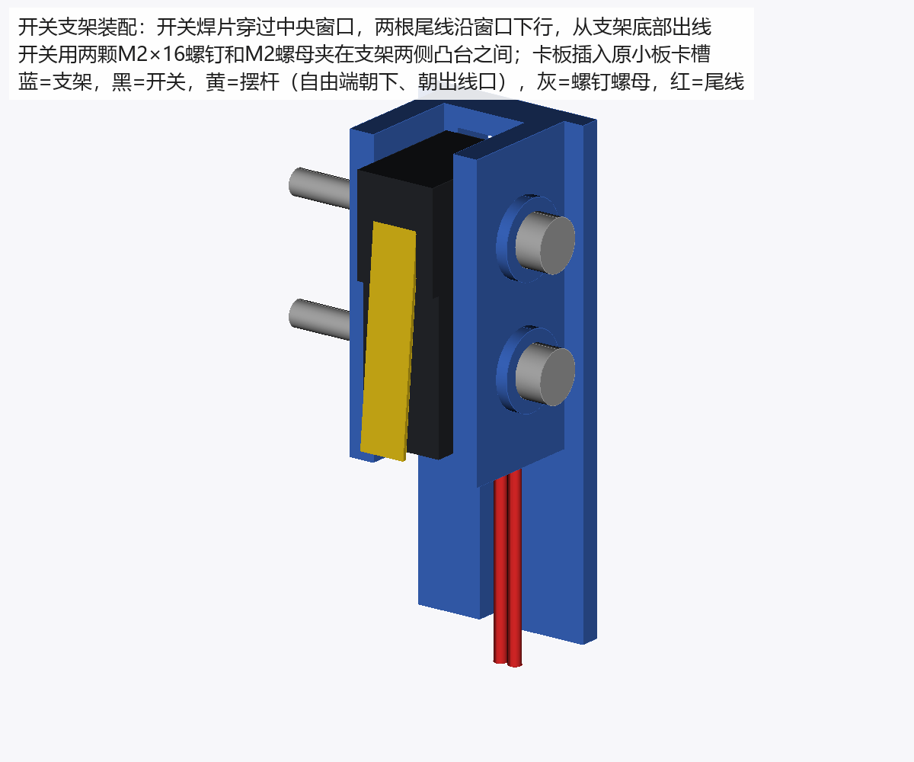
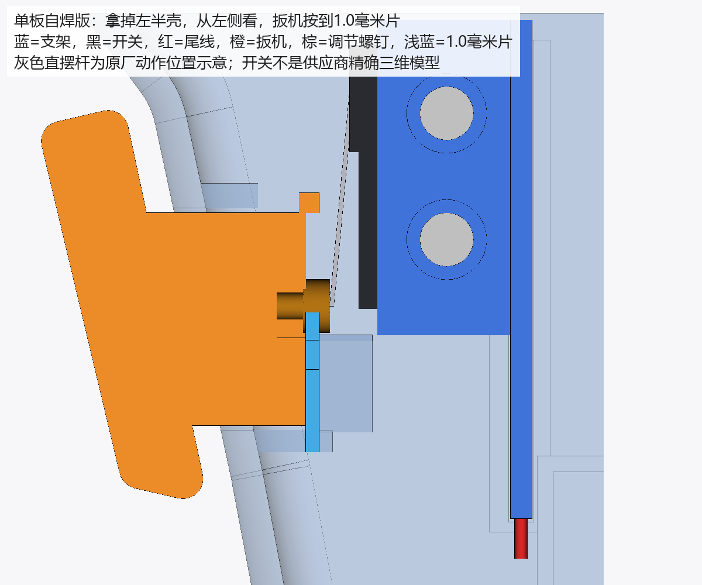

# 扳机装配与调整（单板自焊版）

本版取消扳机小板。扳机开关 **欧姆龙 SS-01GL**（直摆杆、焊片端子，立创编号 C2896769）由你自购，焊两根线后用两颗 M2 螺钉固定在打印的 `扳机开关支架-SS01GL` 上，支架插进左右壳原来放小板的卡槽。

开关底面位置与工厂代焊小板版完全相同（X=-17.1 毫米），所以三片设定片、调节范围和设定方法都沿用。扳机上的调节触点改用市售的 **M2×10 内六角圆柱头螺钉**（原来的 M2 外六角螺栓电商难买），扳机的螺钉头槽和导孔相应改了，必须用本目录的扳机。只用本目录的左半壳、右半壳、扳机、支架和设定片；不要混用工厂代焊版的左右壳，那两件的卡槽向前移了 1.9 毫米，插不进支架。

## 要准备的东西

| 物品 | 数量 | 要点 |
| --- | --- | --- |
| 欧姆龙 SS-01GL | 1（可多买 1 备用） | 直摆杆、焊片端子。不要买 SS-01GL13（弧形杆）、SS-01GL2（滚轮）或带 `D` 后缀的插板脚型号 |
| M2×20 杯头内六角螺钉 | 2 | 穿过支架凸台和开关安装孔；与合壳螺丝同款，和扳机螺钉共用 1.5 毫米扳手 |
| M2 六角螺母 | 2 | 对边 4 毫米、厚约 1.6 毫米，放进支架凸台的六角槽 |
| 细导线 | 2 根，各约 10 厘米 | 一端焊开关，另一端直接焊主板 J4 焊盘；用和 GY 模块同一卷细线即可（外径不大于 1.0 毫米） |
| 热缩管 | 少量 | 包住两个焊点 |
| M2×10 内六角圆柱头螺钉 | 1 | 扳机上的可调触点（GB70.1 / DIN 912，俗称杯头内六角），304 不锈钢或碳钢均可；头径不大于 4 毫米、头厚不大于 2 毫米，最好是滚花头 |
| 1.5 毫米内六角扳手 | 1 | 调节上面这颗螺钉；M2 杯头螺钉买时常附送 |

## 一、焊开关

1. 先认端子：开关本体上印有 COM（公共端）、NO（常开端）、NC（常闭端）。用万用表导通档确认：不按摆杆时 COM–NO 断开，按下时导通。按实物标记和测量结果判断，不要凭"中间脚"来猜。
2. 两根细导线分别焊到 **COM** 和 **NO**。两根线对调不影响按下导通；**NC 不接**，可套一小段热缩管绝缘。
3. 焊点尽量小，不要超出焊片宽度太多。支架中央窗口宽 4.6 毫米，焊片宽 3.2 毫米，焊好的焊点要能从窗口穿过去。线从焊片根部顺着开关底面方向引出。
4. 焊完再测一次：两根线的另一端之间，不按断开、按下导通。

## 二、把开关装到支架上

1. 支架的卡板面朝下平放。开关底面贴着支架托条放入两侧墙之间，三个焊片和两根线从中央窗口穿到卡板背面，两根线沿窗口往下，从支架底部开口引出。
2. **注意朝向**：摆杆在开关背离卡板的一面，摆杆的自由端（末端）要朝支架底部、也就是出线口那一端。开关两个安装孔位置几乎对称，装反也能拧上，但那样摆杆末端朝上，扳机触点压不到动作点。对照下方示意图装。开关两个安装孔对准两侧凸台的孔。
3. 两颗 M2 螺母放进一侧凸台的六角槽，另一侧插入 M2×20 螺钉，穿过开关安装孔拧到螺母里，用 1.5 毫米扳手拧；螺杆穿出螺母约 7 毫米，壳内留有空间。拧到开关不晃即可，不要拧到把开关塑料本体压变形。
4. 按几下摆杆，确认动作和复位顺畅、线没有被夹住。

## 三、先装右半壳并设定触点

1. 把装好开关的支架插进右半壳原小板卡槽，卡板两边进入定位肋，摆杆对着扳机上的螺钉头。不用胶。
2. 尾线从支架底部向下走到主板 J4。J4 不装插座，两根线直接焊到 J4 的两个长条焊盘上（不分正负）；建议主板放进壳之前先焊好，线留够长度，调螺钉时支架还能提起来。走线不要压在扳机滑道、弹簧或壳缝上。
3. 先把 M2×10 内六角圆柱头螺钉从扳机前端的头槽一侧拧进导孔（第一次是在塑料里自攻，会比较紧），先拧到头部底面离头槽底约 1.5 毫米（大致是名义位置）。螺钉头的端面就是压开关摆杆的触点。
4. 装压簧、扳机和触摸面盖，保留触摸线槽。先不合左半壳，以便放入设定片和调螺钉。

**怎么调螺钉**：螺钉头端面朝着开关，内六角孔也在这一面。调的时候把开关支架从右壳卡槽里竖直提起来（尾线可以不拔），露出螺钉头，用 1.5 毫米内六角扳手转，转完把支架插回去再检查。

- 顺时针拧进：触点后退，扳机要压得更深才触发。
- 逆时针拧出：触点伸出，触发更早。
- M2 螺距 0.4 毫米，转 1/4 圈约 0.1 毫米。

有尖嘴钳时，也可以不拔支架，从侧面开口夹住圆柱头转动。螺纹在塑料里自锁，不用胶。

设定片是夹在扳机滑杆后端面与右壳弹簧座之间的打印量片，开口跨过压簧。手柄伸出开壳面，只在左半壳拿掉时使用，合壳前必须取出。末端缺口数：一个缺口 0.8 毫米、两个缺口 1.0 毫米、三个缺口 1.2 毫米。

1. 放入 **1.0 毫米设定片**。先完全松开扳机，再按至设定片限位；按上面的方法少量多次转螺钉，调到开关刚刚导通。用万用表时把电源开关拨到关，在开关的 COM、NO 两个焊片上用导通档测量（线已焊在 J4 上不影响判断）；用程序观察时打开电源开关，不同时用导通档测量。
2. 换成 **0.8 毫米设定片**：先完全松开，再按至片，应导通。
3. 换成 **1.2 毫米设定片**：先完全松开，再按至片，应不导通。每次都要重新完全松开，不能从较深位置回退后直接判断，以免把微动开关的回差当成校准错误。
4. 撤掉设定片：按到底应导通，完全松手必须断开，扳机应自行复位。
5. 合上左半壳，再重复"按到底导通、完全松手断开、顺畅复位"。若合壳前后结果不同，先查支架是否完全入槽、尾线是否挤进滑道、壳体是否完全闭合。

## 螺钉的允许调整量

工程定义中，螺钉头触点静止时的名义端面为 X=-2.0 毫米；δ 是触点相对名义端面伸向开关的量。本版检查范围为 **δ=-1.5～+1.2 毫米**；按原厂动作点 ±0.8 毫米公差计算，所需校准量约 δ=-0.5～+1.1 毫米，落在范围内。

**这是人工校准范围，不是螺钉的止退限制。** 机构没有挡圈阻止螺钉无限退出；右壳硬止挡只限制扳机行程。若三片检查无法同时满足，先核对片厚、支架入槽和开关是否贴紧托条，不能继续向外拧螺钉来硬凑触发。

## 已核对的空间和证据边界

已用实际保存的两侧外壳、主板及元件模型检查：

- 支架、开关本体及焊片、M2 螺钉螺母、两根尾线，与左右壳、主板都没有实体干涉；三者互相之间也不干涉。
- 扳机 4.1 毫米全行程用实体距离界限覆盖整个连续区间；螺钉全部调整量用圆柱包络覆盖。
- 内六角圆柱头按头径 4.0、头高 2.0 毫米检查（标准头径不大于 3.8 毫米），比原外六角头外接圆 4.62 毫米小，原有右壳避让和设定片都够用。头高比原来多 0.6 毫米，所以扳机头槽向里加深到 X=1.7 毫米，导孔从 11.2 加长到 11.8 毫米，导孔外仍保留 1 毫米以上实体壁；最大退出时螺钉尖不顶到孔底。
- 合壳后支架连同开关在 X、Y、Z 正负六个方向都被壳体实体挡住。
- 比到底位置多压 0.5 毫米时，扳机碰到右壳独立硬止挡。

尾线按两根外径 1.0 毫米、从最低焊片以下沿卡板中面下行并穿出支架底部建模；焊片区内贴着焊片走的那一段没有单独建模，焊点大小以装配时能穿过窗口为准。

相对原研究配置，支架做了两处修正：焊片窗与底部出线口原来隔着一条 0.4 毫米细桥，会挡住尾线，现已连通；焊片窗宽度从 3.8 毫米加宽到 4.6 毫米，让焊好的焊点能穿过。修正只写在 `scripts/economy_holder.py`，不改工厂版共用的配置文件。

开关本体、安装孔、焊片和摆杆按[欧姆龙原厂 SS 系列尺寸图](https://omronfs.omron.com/ja_JP/ecb/products/pdf/ss.pdf)建模，不是供应商精确三维模型。检查记录在 `检查报告/扳机与外壳核对.json`。这些是电脑实体和打印网格核对，不能代替实际打印、首件装配和导通测试。
