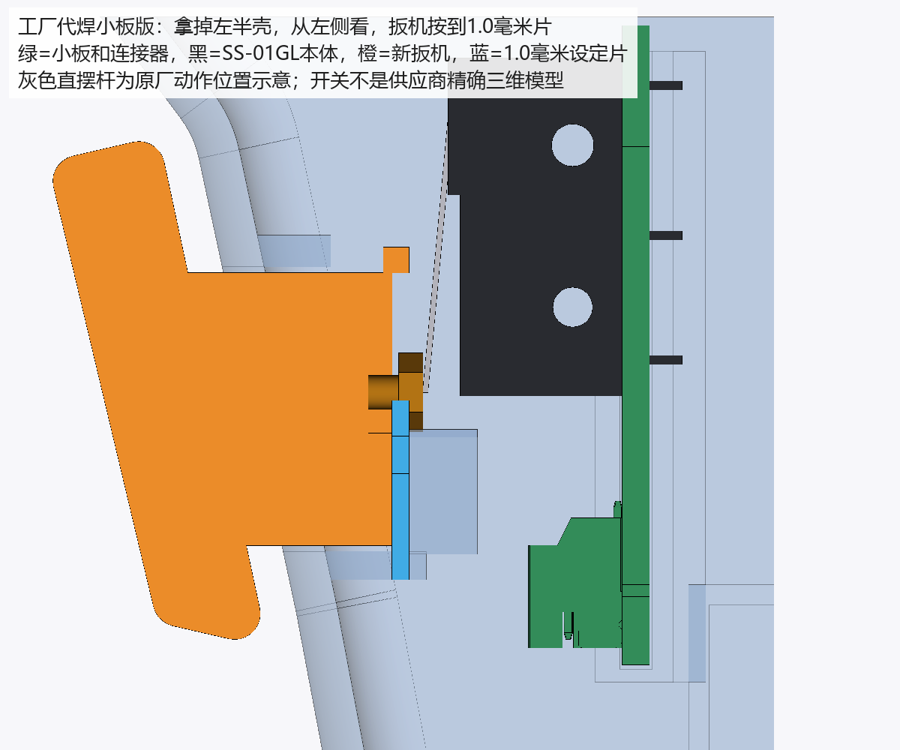

# 扳机装配与调整

本版保留工厂代焊的扳机小板，把原来的 SS-01GL13 换成直摆杆 SS-01GL（立创编号 C2896769）。开关由工厂采购、焊接；是否支持该型号代焊、实际单价及混拼收费，以新订单匹配和工厂审核为准。已查到的立创零售参考价不等于两只器件的贴片订单成交价。

采用本目录的左半壳、右半壳、扳机和设定片；不要混用原工程样的壳体或扳机。两侧小板卡槽及内肋都向枪前方移动了 1.9 毫米，小板元件面的装配坐标从 X=-19.0 改为 X=-17.1 毫米。小板保持原形状和三脚槽孔；本版没有要求用户另买开关或把开关自焊到打印支架上。

新扳机把 M2（公称直径 2 毫米）外六角螺栓轴线下移 3.52 毫米，轴线 Z=-19.02 毫米，对应新开关直摆杆的原厂动作点 Z≈-19.021 毫米。复位弹簧、右壳独立硬止挡、触摸线槽和扳机面盖的功能保留；程序中的灯、触摸和扳机操作逻辑不因这项机械替换而改变。

## 先装右半壳

1. 把工厂焊好的小板和 SS-01GL 插入新右壳卡槽。小板两端进入定位肋，开关摆杆朝扳机的螺栓头；连接器位置延续原小板方向。不要用胶来替代卡槽定位。
2. 按原电路连接小板 J6 和主板 J4。公共端接地、常开端接扳机信号，常闭端不接；以交付电路及接线说明为准，不改变常开触发逻辑。
3. 装原规格压簧、新扳机和触摸面盖，保留触摸线槽。调整螺栓头就是压开关的触点；先不合左半壳，以便放入设定片和转动螺栓。

## 用设定片调整触点

设定片是夹在扳机滑杆后端面与右壳弹簧座之间的打印量片，开口跨过压簧。手柄伸出开壳面，只在左半壳拿掉时使用，合壳前必须取出。末端缺口数分别为：一个缺口 0.8 毫米、两个缺口 1.0 毫米、三个缺口 1.2 毫米。

1. 放入 **1.0 毫米设定片**。先完全松开扳机，再按至设定片限位；缓慢旋转螺栓，调到开关公共端与常开端刚刚导通。使用万用表时先断电并拔开主板J4连接线，再在小板开关的公共端与常开端用导通档测量，避免主板并联路径影响读数。若用程序观察，则正常连接J4并供电，不同时用导通档测量。
2. 换成 **0.8 毫米设定片**。先完全松开，再按至片，应导通或触发。
3. 换成 **1.2 毫米设定片**。先完全松开，再按至片，应不导通、不触发。每次都要重新完全松开，不能从较深位置回退后直接判断，以免把微动开关的回差当成校准错误。
4. 撤掉设定片：按到底应导通，完全松手必须断开，扳机应自行复位。
5. 合上左半壳，再重复“按到底导通、完全松手断开、顺畅复位”。若合壳前后不同，先查小板是否完全入槽、导线是否挤入滑道及壳体是否正确闭合。

按 1.0 毫米片校准后，扳机到底处比动作点多压约 1.0 毫米；右壳实体硬止挡承担继续按压的载荷。原厂资料给出的开关最小允许过行程为 1.2 毫米，名义最不利动作点下螺栓触点与开关塑料平顶还留约 0.4 毫米距离。打印片实际厚度、焊接装配和开关个体仍应通过以上步骤核对。

## 螺栓的允许调整量

工程定义中，螺栓触点静止时的名义端面为 X=-2.0 毫米；δ 表示相对名义端面更压向开关的移动量，正值是触点向开关伸得更长。本版检查范围为 **δ=-1.5～+1.2 毫米**。名义安装位置和原厂动作点 ±0.8 毫米公差对应的校准需求约为 δ=-0.5～+1.1 毫米，落在此范围内。

**这是人工装配校准范围，不是螺栓的物理止退限制。** 机构没有挡圈或其他结构阻止螺栓无限退出；右壳硬止挡只限制扳机行程。不要沿用旧开关的 +2.0 毫米调整端点：在新开关本体位置下，旧端点按到底会进入开关塑料本体。若上述三片检查无法同时满足，先核对片厚、小板入槽和开关焊接位置，不能继续向外拧螺栓来硬凑触发。

## 已核对的空间和证据边界

已按实际保存的两侧外壳、小板、连接器、主板和元件模型检查。扳机 4.1 毫米直线行程使用实体距离界限覆盖整个连续区间；螺栓全部调整量及头部所有旋转角度用圆柱包络覆盖。六角头对边按 4.0 毫米建模，其最坏外接圆直径按约 4.619 毫米检查；这比只检查某个六角朝向更保守。下移后的头槽、右壳止挡中央避让及全部允许调节量均无本体穿透。

闭壳后，小板在 X、Y、Z 三个方向的正负位移都受到卡槽或壳体实体限位；比设计到底位置多压 0.5 毫米时，扳机会碰到右壳独立硬止挡。工厂开关三焊片名义突出 3.5 毫米，穿过 1.6 毫米小板后还露出约 1.9 毫米；焊片厚 0.5、宽约 3.2 毫米，能穿入原 1×4 毫米槽孔。槽孔可穿入并不代表工厂已经接受自动插件或代焊。

开关本体、安装孔、焊片和摆杆模型按[欧姆龙原厂 SS 系列尺寸图](https://omronfs.omron.com/ja_JP/ecb/products/pdf/ss.pdf)建立；不是供应商精确三维模型，摆杆自由位置采用原厂上限示意，正常按压允许与这一示意杆重叠。检查记录在 `检查报告/扳机与外壳核对.json`。这些结果是电脑实体和打印网格核对，不能替代实际打印、工厂审核、首件装配及导通测试。

