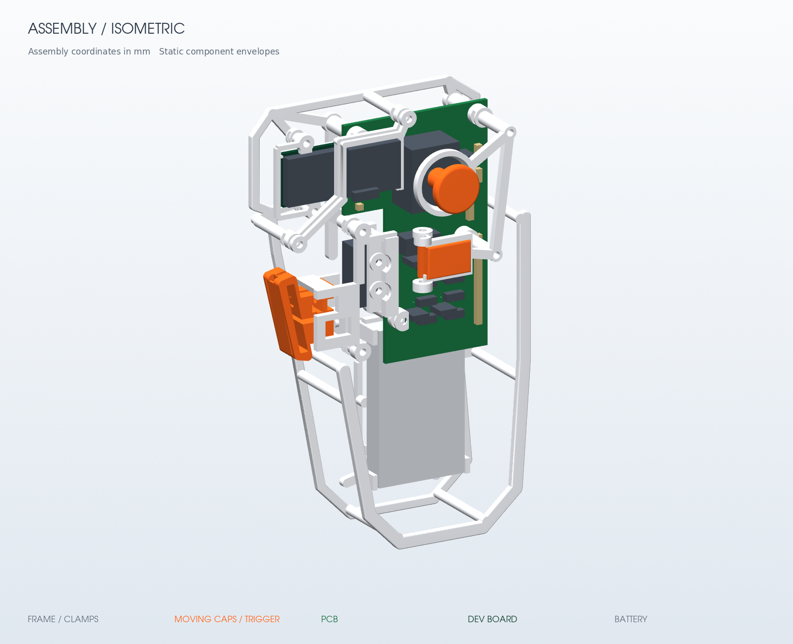

# 30 g 内开放骨架：SuperMini 自焊实验版

本版采用开放骨架、ESP32-S3 SuperMini 与手工焊接载板，允许电路外露和大面积镂空。载板为 52×82 mm，位于 100×100 mm 以内；骨架提供电池托边与绑带点、载板定位与压紧、扳机导向与硬止挡、右键帽沿承压及摇杆局部限位。所有机螺钉统一为之前的 **M2×10 / M2×20 杯头内六角**，配 M2 六角螺母。

30 g 是全部送印树脂件与可剪连接桥的重量门槛，目标约 29 g。估重来自最终模型净体积和材料密度，打印后的实际重量另行称量；工艺支撑是否计入免单以商家规则为准。

本次一体模型含 **13 个打印件**，净体积 **21.056 cm³**（其中连接桥增加 0.310 cm³），按 **1.35 g/cm³ 估重 28.425 g**。打印包尺寸为 **212.13×147.95×33.85 mm**；CAD 有效且为单实体，导出 STL 水密且单连通，网格体积与 CAD 相差 0.00590%。这组数值包含触摸面盖、全部压片、独立 GY 托座和可剪桥，未包含切片工艺支撑。

最终完整 CAD 验收已通过：**4 个载板安装点、14 颗螺钉及其螺母、38 个运动状态、13 条装入路径、5 项线束/绑带包络**。同时验证扳机完整 4.1 mm 行程、右键完整 0.8 mm 行程、触点全调节范围与行程组合，以及摇杆全方位 20°、最差中按 0.9 mm 的桥内包络；完整报告四项通过标志均为 true，报告与打印包的 13 个原位 STEP SHA 一致。它验证当前名义几何和配置包络，实物配合、开关动作、普通树脂握持强度及耐久尚待首样；外置 SPST 不在 CAD 验收范围。

## 下单与装配入口

| 内容 | 文件 |
| --- | --- |
| 全部打印件与可剪连接桥 | [一体送印 STL](generated/onepiece-print.stl) |
| 打印姿态实体 | [一体打印 STEP](generated/onepiece-print.step) |
| 独立零件的原位装配实体 | [原位装配 STEP](generated/assembly-original.step) |
| 件数、体积、估重、变换、STL 检查 | [print-pack.json](generated/print-pack.json) |
| 装配几何、行程、装入路径与螺钉检查 | [assembly-check.json](generated/assembly-check.json) |
| 中文装配、校准与首件检查 | [assembly.md](assembly.md) |
| 正常握持的结构审查与首样边界 | [普通树脂结构审查](research/normal-use-mechanical-review.md) |
| 整套采购与紧固件 | [procurement.md](procurement.md) |
| 打印与计重规则 | [printing.md](printing.md) |
| 元件采购清单 | [PCB BOM](pcb/BOM.csv) |
| PCB 制造参数与焊线表 | [PCB 制造说明](pcb/PCB-manufacture-notes.md) |
| 裸 PCB 制造文件 | [Gerber / drill ZIP](pcb/gun-mouse-supermini-carrier-Gerber.zip) |
| 1:1 焊接与试配模板 | [原尺寸 PDF](pcb/carrier-assembly-map-1to1.pdf) |
| 正面 / 背面预览 | [正面](generated/renders/assembly-front.png) / [背面](generated/renders/assembly-back.png) |
| 等轴 / 爆炸预览 | [等轴](generated/renders/assembly-isometric.png) / [爆炸](generated/renders/assembly-exploded.png) |
| 交付文件与来源 SHA | [artifact-manifest.json](artifact-manifest.json) |

一体送印文件中的零件已经各自旋转并停在骨架旁边。打印后剪断连接桥，装配时按原位 STEP 查看。`print-pack.json` 保存每个零件的正向与逆向变换，不再把经过打印摆放的 STL 当成整机坐标导入。

## 当前电路方案

购买并手工焊接 TENSTAR 双排各 9 引脚的 ESP32-S3 SuperMini（23.5×18 mm）与 GY-601N1 / LSM6DSV16X 模块；载板上的按键、摇杆及无源器件按 PCB BOM 安装。扳机采用 SS-01GL13 焊片开关与打印夹座，不需要扳机小板。具体线焊引脚、供电、电池与首次烧录见 [SuperMini 固件说明](firmware/README.md) 和载板接线资料。

外置电池开关使用成品带线 SPST，以两根扎带固定在后底梁外侧；它尚未建模，需要首件核定绝缘、固定和走线。充电保持 BOOST 开放，连接电脑 USB 前关闭电池，电源路径与到货核对见 [电源资料](research/supermini/power-and-pin-review.md)。



## 生成与复核

本次使用 Python 3、CadQuery 2.7.0、cadquery-ocp 7.8.1.1.post1 和 VTK 9.3.1。Linux 的 X11 版 VTK 需可用的 `DISPLAY` 或 `Xvfb`；可通过 `OPEN_FRAME_XVFB` 指定后者路径。模型生成与打包不需要 EDA 桌面程序。从仓库根目录执行：

```bash
cd experiments/30g-onepiece-test-shell
python build_skeleton.py --measure
python verify_open_frame.py --parts-dir generated --output generated/assembly-check.json
python verify_joystick_hardware.py --parts-dir generated --assembly-report generated/assembly-check.json --output generated/joystick-hardware-motion-check.json
python print_pack.py --from-generated --packing-config packing-plan.json --layout columns
python render_open_frame.py --from-generated --current-references
python build_artifact_manifest.py
```

`verify_open_frame.py` 默认检查完整紧固件、运动、插入路径及线束；`--static-only` 才是静态检查。停车点与功能面保护由 [packing-plan.json](packing-plan.json) 明确记录，每件都有原位坐标中的连接点，触摸盖两大面和各孔等保持面受保护。打包检查单有效实体、全件与连接桥计重、STL 水密且单连通和 CAD/STL 体积一致性，并保存源 STEP 和配置 SHA；渲染参考体只用于展示，不计入送印重量。PCB 与固件的生成命令分别见制造说明和固件说明。

本目录是独立实验，正常握持、树脂配合、充电、实际开关动作和耐久需要首件实测。此前方案可通过 Git 历史追溯，本版送印文件与数据来自 `generated/` 的新报告。
