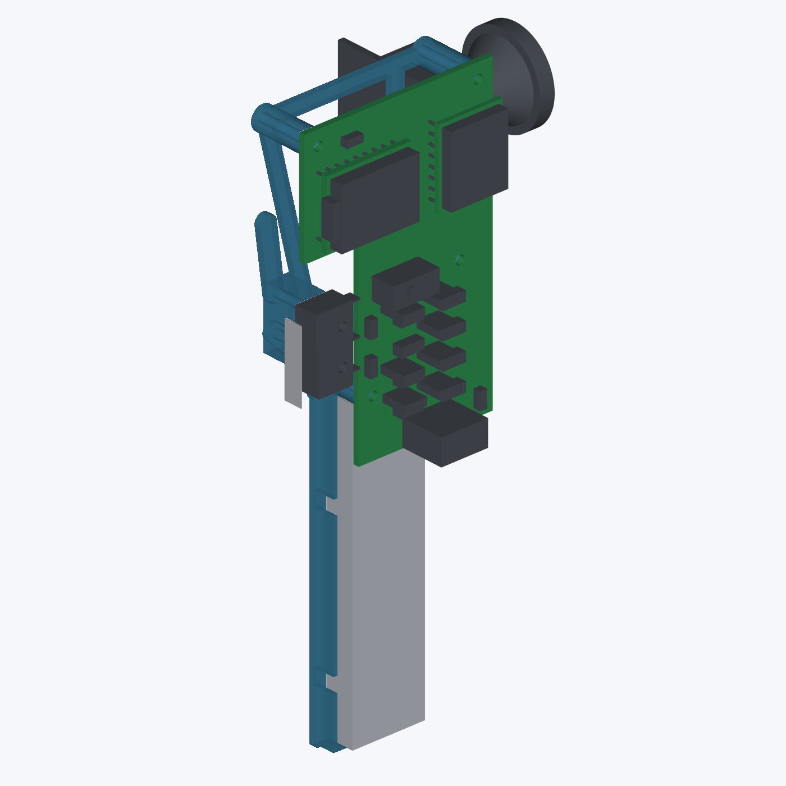

# 第二代：开放工程样机固定底座

这一版只新打印 **1 件底座**，不做握把、左右包覆壳、塑料扳机、额外摇杆帽或外部摇杆限位。载板、开发板、陀螺仪模块和电池外露；握持形状先用纸壳试。现有 **SS-01GL 金属摆杆扳机继续用**，两根软线连接载板，不换 SS-01GLD、不专门开槽。电源拨动开关改用已购买的 **SS12D10 G5**，直接焊在载板上，电池两根线焊到 `J_BAT`。现有 **HW-504 摇杆模块保留自带帽和弯针**，小板与载板垂直，原生帽朝枪尾。

## 打印文件

- [engineering_mount.stl](stl/engineering_mount.stl)：这一版唯一必需的新打印件，已转为平底朝下、毫米单位，100% 尺寸打印。
- [engineering_mount.step](step/engineering_mount.step)：同一底座的可编辑实体，保留整机装配坐标。
- [第二代完整装配.stl](stl/第二代完整装配.stl)：查看整机位置用，包含底座、电路板、器件示意外形和紧固件；不要当作单件打印文件。
- [第二代完整装配.obj](第二代完整装配.obj) 与同目录 [第二代完整装配.mtl](第二代完整装配.mtl)：与完整装配STL使用同一毫米坐标，按器件分组并带基本颜色；两文件放在一起导入。
- [right_cap.stl](stl/right_cap.stl)、[right_cap.step](step/right_cap.step)：第一代右键帽原文件，尺寸与字节均未修改。默认直接按原生右键按钮；本底座没有为帽子另做防脱框，原帽只保留为可选参考，不保证直接套上就能可靠操作，也不需要重新打印。

电池位适配手头 **602060 电池**，按带保护板和出线后的 **20×80×8 毫米**包络预留，电池两侧各留约 0.6 毫米间隙，出线端敞开。底座仍是一件，打印外形约 **50.4×153×15.57 毫米**、实体体积约 **9.57 立方厘米**，按树脂密度 1.2 估约 **11.48 克**；不含绑带、螺丝、电子件和打印支撑。向下的一段只是电池薄托，不是握把。载板外形和四个固定孔未改。开发板和陀螺仪都移到载板正面直接插焊，删除原来的外伸托架；摇杆黑板为实测 **34×26 毫米**，杆沿整机 **-X** 朝枪尾，平行于载板，周围没有限位圈。

选韧性树脂或尼龙。普通脆树脂的高柱和摇杆窄边托在装配中容易被掰断；支撑不要落在载板柱顶、模块边托、SS 螺母槽和绑带槽内。固定孔为名义间隙孔，首件仍要检查收缩、毛刺和实物配合，不强拧扩孔。

## 固定和装配

沿用已有 M2×20 杯头内六角螺丝 **6 颗**、M2 螺母 **6 个**：4 组夹载板，2 组固定 SS。载板正面螺母直接轻夹，不为这四处额外买特殊垫片。另用 SS 原有 M2 薄垫片填平侧面间隙、三条窄软绑带（电池两条、摇杆一条）和薄绝缘软垫。

**先试装再焊接。** 开发板和陀螺仪不再外置，用两排针直接固定到载板；底座只保留载板四柱、摇杆薄托、SS两孔座和电池托：

1. 先把载板从正面放到四柱上，四颗 M2×20 从底座背面向元件面穿入，正面轻锁螺母。底座背面用 1.5 毫米内六角扳手拧螺丝，正面用薄钳扶住螺母，不把载板压弯。
2. SuperMini 两排各9针、GY 左8右6排针由载板正面插入，模块与载板留 **3毫米**间隙；在背面焊接，焊后针尾不超过载板背面1毫米。SuperMini元件面朝前，USB朝枪口方向；背面的电池B+/B-仍接两根短线。GY右排首孔、末孔分别对齐左排第2孔、第7孔，其他闲脚不额外接地。
3. 电池使用手头 **602060、带保护板**型号，电芯名义 6×20×60 毫米；底座按含保护板和出线的 **20×80×8 毫米**包络预留。保护板与出线朝向载板一端，该端没有端墙。薄托上先铺柔软绝缘垫，放入电池，两条软绑带穿槽固定。只收紧到不晃动，不勒凹电池；电池不承担握力，不让焊脚或螺丝抵到电池。电池线从敞开端引出，留卸力余量，再焊 `J_BAT`，极性以载板丝印和接线表为准。
4. SS-01GL 放在一体两孔座上。开关本体与座之间的名义间隙为 0.6 毫米，可先沿用每孔两片 0.3 毫米垫片，再按实物厚度调整，两孔同侧垫片总厚一致。不要靠拉弯塑料座填间隙。两个 M2 螺母从底座侧槽放入，M2×20 从开关外侧穿入锁紧，多余螺杆藏在底座柱孔中。直接按金属摆杆；原生推钮、铰接和摆杆全行程保持空旷。COM 和 NO 各一根软线接 `J_TRIG`，NC 不接；先用万用表确认端子。
5. HW-504现有弯针由载板背面插入，五针从整机Z高到低依次为 **GND、3.3V、VRx、VRy、SW**。黑板垂直载板、向背面伸出，原生摇杆帽朝 **-X枪尾**。靠排针的空白板边放在开放薄托上，以一条软绑带固定；按实际弯针偏移垫少量绝缘软垫，不挤压金属本体、帽和轴。模块供3.3V，尽管自身丝印可能写着+5V。周围没有额外机械限位。
6. 原触摸电极移到 SS 金属摆杆：**薄绝缘胶带 → 铜箔 → 薄绝缘胶带**。铜箔只接 `J_TOUCH/1`，不接 SS 的电气端子或地。导线避开铰接和推钮，留出按下与回弹余量，并在底座附近卸力。贴好后验证完整按下、松手回弹、触摸门限；金属底层会改变触摸电容，需要实测调整。

板载电源开关、电池永久焊接、电源与 USB 的接法，以 [载板说明](../pcb/README.md) 为准。没有新增外置电源开关壳。

手握先用纸板和绝缘胶带做薄套，只包住需要握的边和焊脚面；不要把电池当握把捏，也不要用手掌挤压陀螺仪、开发板焊点或金属摆杆。先找合适的宽度、角度和手指位置，后续再决定握把形状。

## 文件核对的边界

[assembly-check.json](assembly-check.json) 来自 [生成工具](../tools/build_gen2_mount.py)，核对名义实体有效且只有一个连通体、与器件/焊脚保守包络的干涉、上述直线装配路径的连续包围盒、6 组紧固件及螺母槽/轴向工具空间，以及打印网格闭合与体积。HW-504黑板尺寸与针距由用户确认；弯针转角偏移、摇杆轴心和帽的外形仍为保守示意，不是精密实物复刻。

首件还需实物核对：器件批次尺寸、绑带落点、树脂收缩和强度、SS 手指可达与回弹、摇杆全部方向及中键、触摸门限、模块稳固程度、无线连接和电池温升。预览中的器件是保守外形示意，柔性金属摆杆并非原厂动作模型。
